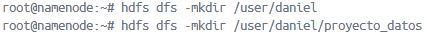
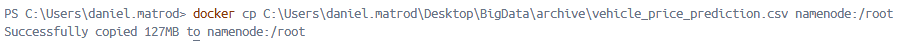
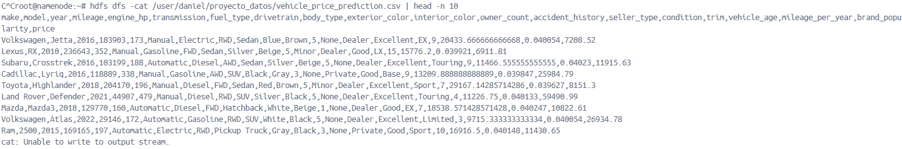
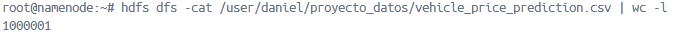
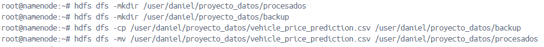
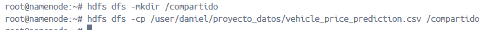
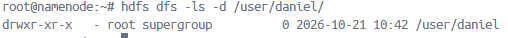
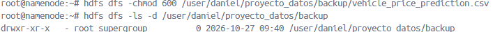
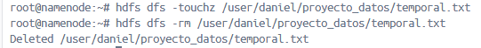

# PR0202 - Uso del cliente HDFS

1. Preparación del entorno

Creo la estructura de directorios

2. Carga de datos

Abro una nueva terminal que no se encuentre dentro de hadoop y copio el archivo al sistema local de hadoop. Luego vuelvo a la terminal en la que me encuentro dentro de hdfs y lo muevo a la carpeta que creamos antes.

3. Exploración de datos

Visualizo el contenido con el comando cat. Utilizo modificador head para mostrar las 10 primeras lineas ya que es un archivo muy grande.

Para saber el número de líneas que tiene el archivo utilizo el mismo comando con el modificador "wc -l".

4. Organización del proyecto

Creo las carpetas de procesados y backup. Copio el archivo a backup con cp y lo muevo de proyecto_datos a procesados con mv.

1. Colaboración en el equipo

Creo la carpeta nueva y copio ahi el archivo.

6. Recuperación de datos

Recupero el archivo al sistema local con get.

7. Control de accesos

Verifico los archivos de mi carpeta personal con el comando ls y el modificador -d. 

Edito los permisos para dejar solo el de lectura y escritura en mi usuario.

8. Mantenimiento

Simulo la creación de un archivo temporal con el comando touchz que es el equivalente de touch en hdfs y lo elimino con -rm.

---
[Atrás](../index.md)